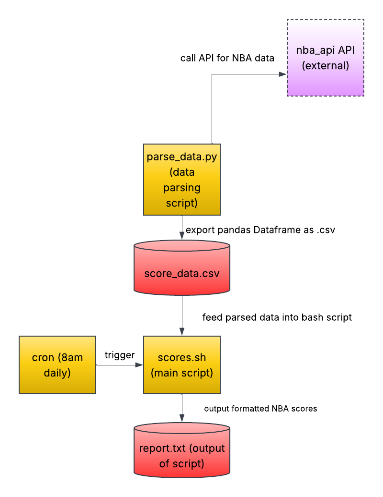

# nba-scoreboard-fetcher
Fetches NBA scores from last night and sends them to a report you can read every morning at 8:00AM.
## The Problem
As a passionate NBA fan and fan of the Indiana Pacers, I find it very tedious trying to figure out the top players in the league statistically at any given moment of the season and also getting a daily breakdown of scores around the league from the previous day, top performances, and the current standings across both conferences. While tools like nba.com and ESPN exist for attending to these needs, I still find it inefficient to have to dig through these websites to try and find what I am looking for in the world of NBA basketball. Thus, I am trying to solve this problem through an automated and personalized daily breakdown of what is going on around the league.
## How It Works
This workflow involves a cron job at the center of the automation, a python script parsing the data, and a bash script that is taking in the formatted data and outputting it to a report.txt file on the user's computer. The workflow starts with the cron job running automatically at 8:00AM in the morning every day of the week. This triggers the bash script that will output the formatted scoreboard from last night. In order to get there, we go up to the python script that actually parses the data. The python script utilizes the free, public, and open-source nba_api API in order to scrape data about last night's scoreboard and parse it / format it into a pandas DataFrame readable by a fan. After getting this pandas DataFrame, we need to convert it into a parse_data.csv file that is fed to the bash script to be read. Once the bash script receives this data store, it works to output the scoreboard data to a report.txt file, showing the user at the same time every morning the scoreboard from last night's NBA action.

