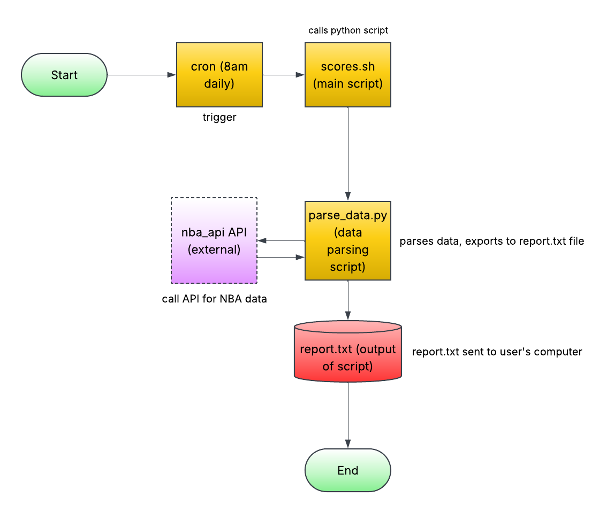

# nba-scoreboard-fetcher
Fetches NBA scores from last night and sends them to a report you can read every morning at 8:00AM.
## The Problem
As a passionate NBA fan and fan of the Indiana Pacers, I find it very tedious trying to figure out the top players in the league statistically at any given moment of the season and also getting a daily breakdown of scores around the league from the previous day, top performances, and the current standings across both conferences. While tools like nba.com and ESPN exist for attending to these needs, I still find it inefficient to have to dig through these websites to try and find what I am looking for in the world of NBA basketball. Thus, I am trying to solve this problem through an automated and personalized daily breakdown of what is going on around the league.
## How It Works
This workflow involves a cron job at the center of the automation, a python script parsing the data and exporting it into a report.txt file, and a bash script that is running the python script to output the report.txt file to the computer. The workflow starts with the cron job running automatically at 8:00AM in the morning every day of the week. This triggers the bash script that will execute the python script that outputs the report.txt file to the computer. In order to get there, we go up to the python script that actually parses the data. The python script utilizes the free, public, and open-source nba_api API in order to scrape data about last night's scoreboard and parse it / format it into a pandas DataFrame that will be eventually readable by a fan. After getting this pandas DataFrame, we need to convert it into a readable report.txt file that allows a fan to see the scoreboard cleanly and clearly. Once the bash script is run, it executes the python file which outputs this report.txt file, showing the user at the same time every morning the scoreboard from last night's NBA action.



## Tech Stack

- **Languages:** Bash and Python
- **Libraries/Utilities:** Cron (Scheduling Utility) and pandas (Python Library)
- **External tools:** free, public, and open-source API nba_api

## Setup
**Note:** You will need Git, Python 3, and Ubuntu (including WSL Ubuntu) for setup.
Follow the steps below in order to install and prepare the NBA Scoreboard Fetcher on Ubuntu.
1. In your terminal, clone the repository:
   ```bash
   git clone https://github.com/PurduePanda/nba-scoreboard-fetcher.git
   ```
2. After cloning, switch to the project root directory:
   ```bash
   cd nba-scoreboard-fetcher
   ```
3. From the repository root directory, run:
   ```bash
   python3 -m venv .venv
   ```
4. On Ubuntu, run:
    ```bash
    source .venv/bin/activate
    ```
5. To install dependencies, run:
    ```bash
    python -m pip install nba_api
    ```
**NOTE:** If Ubuntu reports that the `venv` module is unavailable,
install it using:
```bash
sudo apt install python3-venv
```

## Usage

### Manual Execution
From the project root directory, run:

```bash
bash scores.sh
```
After running the script, open `report.txt` in the root directory of your project to view the NBA Scoreboard from yesterday. The report shows you the scoreboard for each game with team names, final scores, and each team's record (Wins-Losses) on the season. To view the `report.txt` file from Ubuntu, you can run:
```bash
cat report.txt
```

### Automated Execution
**NOTE:** Your computer must be powered on and the WSL and the cron service must be running at the scheduled time (8:00AM) in order for the automated execution to work. Make sure to check your time zone using ```timedatectl``` in your terminal to check what configured time zone you are using. The command for the daily schedule in step 3 uses ```0 8 * * *``` which runs at 8:00AM according to the cron service's configured time zone. Ensure you configure cron service for the appropriate time zone of your choosing.
1. Run ```pwd``` from your repository root to find the absolute path of the project.
2. Open the cron editor using the command:
   ```bash
   crontab -e
   ```
3. Add the daily schedule using the absolute project path to `scores.sh` by doing:
   ```bash
   0 8 * * * /bin/bash {absolute_project_path}/scores.sh
   ```
4. Save and verify the configuration using ```crontab -l```

**NOTE:** You must replace {absolute_project_path} with your actual directory for the project root directory in order to correctly add the daily schedule.


## Roadmap
- [ ] Scrape Data from the Conference Standings for both East and West
- [ ] Scrape Data from the League Leaders in Major Statistical Categories (PTS, REB, AST, etc.)
- [ ] Scrape Data for a Specific Player's Career or Seasonal Totals Across Major Statistical Categories

## Author
Patrick Buckley (github.com/PurduePanda)
